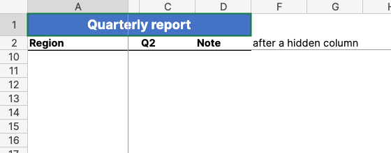

# What the grid shows

What a cell shows comes from SharpCell, and how the sheet is laid out follows Excel at 100% zoom.

## Values and number formats

Each cell shows `Cell.Text`: the value through its number format, with the workbook's culture.
Excel's General alignment puts numbers and dates on the right, text on the left, logical values
and errors in the middle.

A number too wide for its column is shortened as Excel does it: a number in the General format
loses decimals, rounding, or digits of its scientific notation; any other number shows `#` across
the cell. Text is never shortened.

## Styles

`Cell.Style` gives the font (name, size, bold, italic, underline, strikethrough, colour), the
fill, the four edges of the border and the alignment. Fills lie over the gridlines, as in Excel.
Wrapped text breaks onto more lines inside its cell; an indent moves text away from the edge it
is aligned to.

## Sizes and merged cells

Column widths and row heights come from the sheet, in pixels as Excel converts them: a width is
counted in digits of the workbook's default font, so it follows the font the grid measures with.
Hidden rows and columns take no space. A merged area shows its top-left cell across the whole
area; clicking anywhere in it selects that cell, and the arrow keys step over it as one cell.

## Running text

Text wider than its cell runs on over empty neighbours, away from the side it is aligned to: to
the right when left-aligned, to the left when right-aligned, both ways when centred. A cell with
content, a formula that gives empty text, or a merged area stops it. Numbers, wrapped text and
merged cells never run on.

## Frozen panes and gridlines

Frozen rows and columns stay in place while the rest scrolls, with a line where they are frozen,
as Excel's Freeze Panes. A sheet with gridlines turned off shows none.

## Mouse and keyboard

| Input | Result |
|---|---|
| Click on a cell | Selects it alone; inside a merged area, the area |
| Drag | Selects from where the drag started; past an edge of the view it scrolls after the mouse |
| Shift+click | Extends the selection from the active cell |
| Click or drag on column or row headers | Whole columns or rows; the active cell is the first on screen |
| Click on the corner above the row headers, Ctrl+A (Cmd+A on macOS) | The whole sheet |
| Arrow keys | Move the active cell one cell, over a merged area as one cell, and select it alone |
| Shift+arrow keys | Extend or shrink the selection at its far corner |
| Ctrl+Space, Shift+Space | Whole columns, whole rows of the selection |
| Enter, Shift+Enter | Down, up; inside a selection, to the next selected cell, column by column |
| Tab, Shift+Tab | Right, left; inside a selection, to the next selected cell, row by row |
| Ctrl+C (Cmd+C on macOS) | Copies the selected cells |
| Wheel | Three rows a turn |

A selection covers every merged area it touches whole. Selected cells but the active one are
shaded, a border goes round them, and the headers of their rows and columns are highlighted.

## Copying to Excel

Copying puts the selected cells on the clipboard in two forms, both read by Excel when it pastes:

- Text, as Excel copies it: a tab between cells, a line break after each row, text with line
  breaks in quotes. Other applications, such as editors and chat, take this form.
- An HTML table with each cell's font, fill, borders and alignment, and merged areas as one cell.
  Excel and other spreadsheets paste it with its styles; text stays text, even when it reads as a
  number.

Cells are copied as shown, in their number format: `1,250.00` rather than `1250`, and a formula's
value rather than the formula. Hidden rows and columns are copied. Whole columns or rows end at the
sheet's last used row or column.

## Where it differs from Excel

- Fonts the system does not have fall back to another font, so sizes follow the font that is used.
- Double underlines are drawn single; Fill, Justify and Distributed alignment are drawn as left or centred.
- Theme colours with a tint, indent steps and centred text blocked on one side follow the OOXML
  definitions; they are not yet compared with Excel.
- A merged area across the line of frozen panes is drawn whole from the frozen part.
- The colours of the selection, its shade and its headers are close to Excel's, not measured from it.
- Ctrl+A selects the whole sheet at once, not first the cells around the active one; Ctrl with the
  arrows, Home, Page Up and Page Down do not move yet, and only one rectangle can be selected
  (no Ctrl+click).
- Copied HTML is not yet checked by pasting it into desktop Excel.
- Not shown: conditional formats, pattern and gradient fills, rotated text, styles of whole rows
  and columns on empty cells, charts, images and comments.
