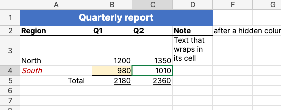

# SharpCell.Grid

A free (MIT) Excel-like spreadsheet control for .NET 8 and later, built on the
[SharpCell](https://ifmelate.github.io/SharpCell/) formula engine. It shows a worksheet the way
Excel does: each cell's value in its number format and its style, the file's column widths and
row heights, merged cells, frozen panes and text running on over empty cells.

**[Try it in your browser](https://ifmelate.github.io/SharpCell.Grid/demo/)**: open your own .xlsx file; it is read on your computer and never uploaded.



| Package | What it does |
|---|---|
| `SharpCell.Grid` | Geometry, hit testing, scrolling and painting, with no UI framework. |
| `SharpCell.Grid.Avalonia` | `SpreadsheetView`, the control for [Avalonia UI](https://avaloniaui.net). Brings `SharpCell.Grid` with it. |

Namespaces: `SharpCell`, `SharpCell.Xlsx` and `SharpCell.Grid.Avalonia`.

```csharp snippet=show-workbook
Workbook workbook = XlsxReader.Load(path);
workbook.Recalculate();

var view = new SpreadsheetView { Worksheet = workbook["Budget"] };
```

Only the visible cells are read when the grid paints, so a sheet of a million rows scrolls like
an empty one. What a cell shows comes from SharpCell: `Cell.Text` for the value through its number
format, `Cell.Style` for the font, fill, borders and alignment. Both are checked against Microsoft
Excel.

Status: 0.x, viewing only. Range selection, copying and WPF come next, then editing; see the
[roadmap](roadmap.md). The API may change between minor versions until 1.0.

- [Getting started](getting-started.md)
- [What the grid shows](guides/showing-workbooks.md)
- [Painting in other UI frameworks](guides/painting.md)
- [API reference](api/index.md)
